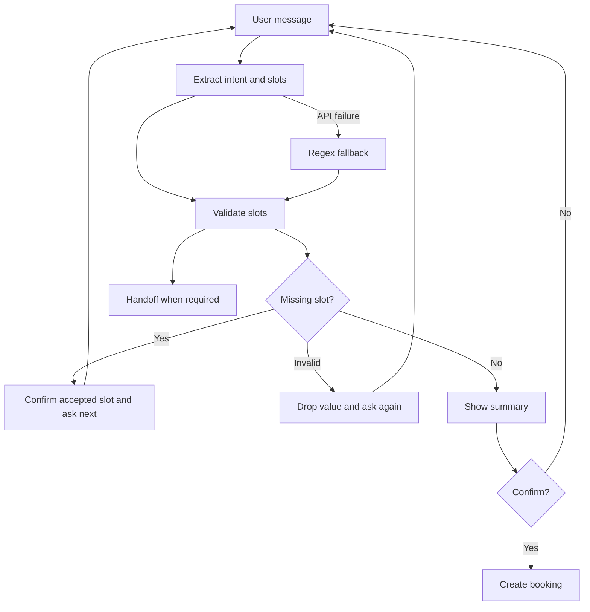

# CineBot Design

## 1. Business goal

CineBot helps a small theater reduce calls to the front desk.

- SMART goal: five turns or fewer for at least 85 percent of valid requests.
- Slot F1 target: 90 percent.
- Out of scope rejection target: 90 percent.

## 2. Scope

CineBot supports three tasks.

- BookTickets collects a movie, date, showtime, ticket count, and format. It checks catalog.json. It asks for confirmation, then returns a mock reference.
- CheckShowtimes lists showtimes and formats for a movie or date.
- CancelBooking cancels a reservation with a reference such as CB-4829.

CineBot does not give movie reviews or recommendations. It does not handle trivia, food orders, or unrelated questions. It gives a polite reply for those requests.

The bot sends a user to a person for a billing dispute, refund request, group larger than ten, or accessibility request. It also sends a user to a person after three failed turns.

## 3. Intents

BookTickets means that the user wants seats.

- Can I get two tickets for Dune: Part Two tonight at 7 PM?
- Book four IMAX seats for Oppenheimer on Friday.
- I want one standard ticket for Inside Out 2 tomorrow.
- Get three seats for the 9:30 PM Civil War show.

CheckShowtimes means that the user wants available times.

- What times is Dune: Part Two on today?
- Do you have IMAX this Saturday?
- When is the next Oppenheimer show?
- What movies are on tomorrow night?

CancelBooking means that the user wants to cancel a reservation.

- Cancel my reservation CB-4829.
- Please void order CB-1094.
- Cancel CB-9921.
- I cannot attend. Cancel my reservation.

System intents are Greeting, Help, Cancel, Confirm, Deny, Handoff, and None.

Greeting answers a hello. Help lists the bot services. Cancel clears the active task. Confirm accepts the final summary. Deny rejects the summary or supplies a correction. Handoff sends the user to a person. None covers unrelated requests.

## 4. Slots

- Movie: catalog value. Dune 2 and Oppy map to full titles.
- Date: ISO date. today, tomorrow, this Friday, and Oct 15 are valid forms.
- Time: catalog showtime. 7 PM and 19:00 map to 19:00.
- Tickets: integer from 1 to 10. two, a pair, and me and my friend map to integers.
- Format: Standard, IMAX, or 3D. Standard is the default.
- Booking ID: CB followed by four digits.

## 5. Main flow

- The app sends user text to extraction.
- The model returns one intent and raw slot values.
- Python checks the values against the catalog.
- The regex fallback runs after a model error.
- Dialog state stores accepted slots.
- The bot confirms each accepted slot and asks for the next missing slot.
- The bot drops invalid values and repeats the same question.
- The bot shows a summary when all booking slots are valid.
- The bot creates a mock reference after confirmation.

The dialog manager never uses raw text. It uses only validated values. This keeps catalog checks and confirmation logic outside the model.

## 6. Tool and voice support for Extra Credit :)

The Track A agent can call `check_availability` when a user asks about
showtimes or prices. The function reads catalog.json and returns the
movie, format, showtimes, price, and date. Python runs the call through the
allow-list in tools.py. Unknown tool names are rejected. The agent allows at
most five tool iterations.

We created our own start and stop controls for voice mode with
`streamlit-mic-recorder` so it is easier to use. Whisper converts the
recording to text. The normal extraction and dialog flow then handles it.
The reply is sent to tts-1 and played in the browser. The sidebar reports
extraction latency and the combined voice latency for each voice turn.

## 7. Track choice

Track A fits this task because users can give several values in one sentence.
They can use nicknames, number words, abbreviations, and informal time
phrases.

The model extracts the values. Python checks the values and controls the
state. This split limits false showtimes and prevents a model reply from
completing an order without confirmation.
