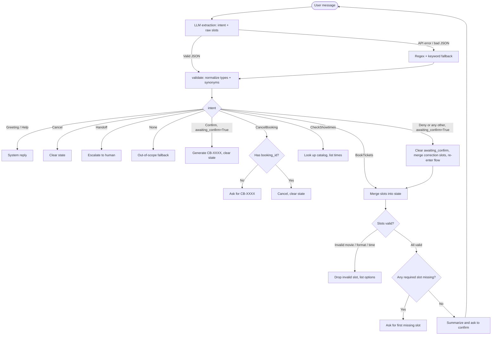

# Design — CineBot

## 1. Business goal

Automate ticket reservations and showtime lookups for a small independent theater to cut front-desk call volume.

SMART goal: complete a ticket reservation in 5 turns or fewer for at least 85% of valid booking requests, with 90%+ slot F1 and 90%+ out-of-scope rejection on the evaluation set.

## 2. Scope

The bot handles three tasks.

BookTickets: collect movie, date, showtime, ticket count and format, validate against catalog.json, confirm, and return a mock booking reference.

CheckShowtimes: list available times and formats for a movie or date from catalog.json.

CancelBooking: cancel a reservation by booking reference (format CB-XXXX).

Out of scope: movie recommendations, reviews, trivia, concession orders, and anything unrelated to the theater. The bot gives a polite fallback for these.

Human handoff triggers: billing disputes or refund requests, groups larger than 10, accessibility accommodation issues, and 3 consecutive turns where the bot cannot understand the user.

## 3. Intents

Task intents:

BookTickets — reserve seats for a screening.
- "Can I get two tickets for Dune: Part Two tonight at 7:00 PM?"
- "Book 4 IMAX seats for Oppenheimer on Friday."
- "I'd like to reserve one standard ticket for Inside Out 2 tomorrow evening."
- "Grab me three seats for the 9:30pm showing of Civil War."

CheckShowtimes — ask what's playing or when.
- "What times is Dune: Part Two playing today?"
- "Do you have any IMAX screenings this Saturday?"
- "When is the next showing of Oppenheimer?"
- "What movies are showing tomorrow night?"

CancelBooking — cancel a reservation by reference code.
- "I need to cancel my reservation CB-4829."
- "Can you void my ticket order? The confirmation code is CB-1094."
- "Cancel booking CB-9921 please."
- "I can't make it tonight, cancel my existing booking."

System intents:

Greeting — hi, hello, good morning, etc.
Help — asking what the bot can do or how to use it.
Cancel — abort the current task and start over.
Confirm — yes, confirm, book it, go ahead (used at the confirmation step).
Deny — no, change something, or a slot correction like "make it Saturday instead" or "switch to Interstellar". The corrected slot value is extracted alongside the Deny intent.
Handoff — billing, refund, group over 10, accessibility needs.
None — everything else out of scope.

## 4. Slots

movie: catalog list. Validated against catalog.json. Synonyms like "Dune 2" or "Oppy" are resolved to canonical titles. Required for BookTickets and optionally for CheckShowtimes.

date: date string. Resolved in Python from relative phrases like "today", "tomorrow", "this Friday" to ISO YYYY-MM-DD. Required for BookTickets, optional for CheckShowtimes.

time: showtime. Normalized from 12h or colloquial forms to HH:MM (24h), then validated against the movie's showtimes in catalog.json. Required for BookTickets.

tickets: integer 1-10. Word forms like "two" or "me and my friend" are resolved to integers. Values over 10 trigger human handoff. Required for BookTickets.

format: Standard, IMAX, or 3D. Synonyms like "regular", "2D", "reald 3d" are resolved. Validated that the chosen movie offers that format. Defaults to Standard if not specified. Required for BookTickets.

booking_id: regex CB-\d{4}. Required for CancelBooking.

## 5. Dialog flow

## 6. Track choice

I chose Track A (LLM hybrid with gpt-4o-mini and Streamlit) because ticket booking involves messy natural language with multi-slot sentences, colloquial time references, number words, and movie nickname synonyms. The LLM handles all of this in a single extraction call. Catalog validation, state transitions, and confirmation logic stay in deterministic Python, so the bot cannot hallucinate an unavailable showtime. This split also makes the system easy to evaluate quantitatively and compare against Track B's bag-of-words approach in the report.