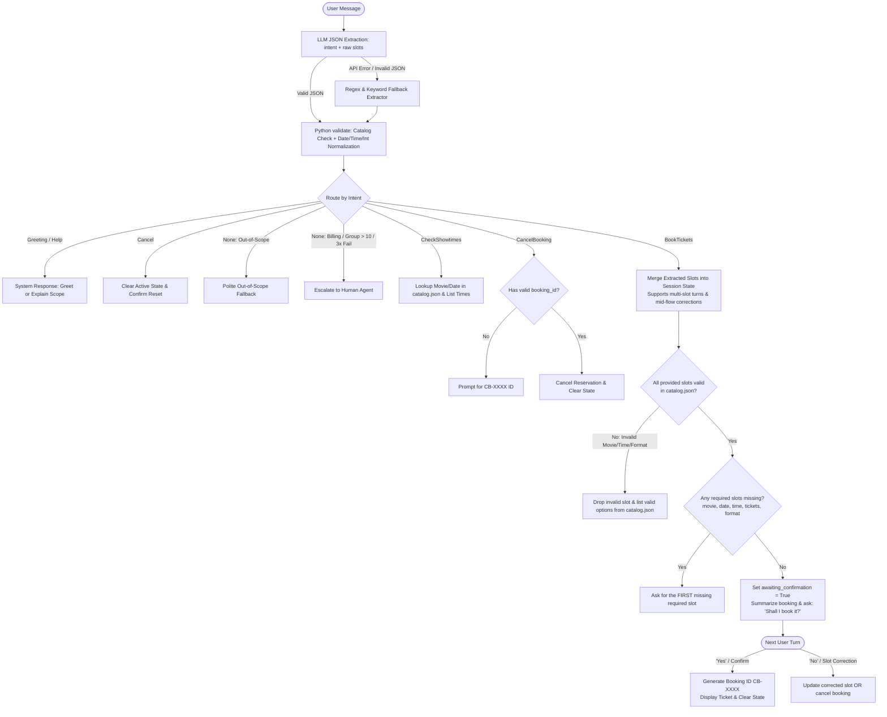

# DESIGN.md — CineBot: Cinema Ticket & Showtime Assistant

## 1. Business Goal & SMART Goal
* **Business Goal:** Automate box-office ticket reservations and showtime inquiries for an independent movie theater to reduce front-desk phone volume and speed up customer checkout.
* **SMART Goal:** Successfully complete ticket reservations (all required slots filled, validated against the catalog, and confirmed by the user) in **5 turns or fewer for at least 85% of valid booking requests** on the evaluation set, while maintaining **90%+ slot F1** and **90%+ out-of-scope rejection accuracy**.

---

## 2. Scop

### What the bot DOES (In-Scope)
* **Book movie tickets (`BookTickets`):** Collects movie title, date, showtime, ticket quantity, and screening format, validates them against `catalog.json`, confirms the reservation details, and issues a mock booking reference.
* **Check showtimes (`CheckShowtimes`):** Queries `catalog.json` to list available screening times and formats for a specific movie or date.
* **Modify or cancel an existing booking (`CancelBooking`):** Cancels a completed reservation using a 6-character booking reference ID (e.g., `CB-4829`).

### What the bot DOES NOT do (Out-of-Scope → Polite Fallback)
* Movie recommendations, plot summaries, reviews, or trivia (*"Who directed Dune?"*, *"What's a good scary movie?"*).
* Concession stand orders or pricing (*"How much is a large popcorn?"*).
* General knowledge, chitchat, math, or unrelated tasks.

### When a Human Takes Over (Escalation / Handoff)
The bot immediately triggers a human handoff (`Handoff` state) when the user asks about:
1. **Billing & Refunds:** Credit card disputes, double charges, or refund requests for past showtimes.
2. **Group / Private Events:** Bookings of more than 10 tickets or private theater rentals.
3. **Accessibility & Special Accommodations:** Wheelchair companion seating issues or assistive listening device reservations.
4. **Repeated Failures:** 3 consecutive turns where the bot fails to validate a slot or understand the user's intent.

---

## 3. Intents

### Task Intents (3)

#### 1. `BookTickets`
Reserve seats for a specific movie screening.
* *"Can I get two tickets for Dune: Part Two tonight at 7:00 PM?"*
* *"Book 4 IMAX seats for Oppenheimer on Friday."*
* *"I'd like to reserve one standard ticket for Inside Out 2 tomorrow evening."*
* *"Grab me three seats for the 9:30pm showing of Civil War."*
* *"Actually, make that 3 tickets in IMAX for Saturday."*

#### 2. `CheckShowtimes`
Ask what movies are playing or check specific screening times/formats.
* *"What times is Dune: Part Two playing today?"*
* *"Do you have any IMAX screenings this Saturday?"*
* *"When is the next showing of Oppenheimer?"*
* *"What movies are showing tomorrow night?"*
* *"Are there any matinee showtimes for Inside Out 2 on Sunday?"*

#### 3. `CancelBooking`
Cancel an already confirmed ticket reservation using a booking ID.
* *"I need to cancel my reservation CB-4829."*
* *"Can you void my ticket order? The confirmation code is CB-1094."*
* *"Cancel booking CB-9921 please."*
* *"I can't make it to the movie tonight, please cancel myexisting booking."*

---

### Control & System Intents (4)

#### 4. `Greeting`
* *"Hi there!"*
* *"Hello, good evening."*
* *"Hey CineBot, are you there?"*
* *"Good morning!"*

#### 5. `Help`
* *"What can you help me with?"*
* *"How do I book a ticket here?"*
* *"What commands do you understand?"*
* *"I'm stuck, what are my options?"*

#### 6. `Cancel` (Abort current in-progress dialog)
* *"Cancel that, start over."*
* *"Never mind, forget it."*
* *"Stop, I don't want to book anymore."*
* *"Quit current task."*

#### 7. `None` (Out-of-scope or human handoff triggers)
* *"What is the capital of France?"*
* *"Can I order a large popcorn and a soda?"*
* *"I was charged twice on my Visa card yesterday and need a refund."*
* *"Who won the Oscar for Best Picture in 2024?"*
* *"I want to rent out an entire theater for 45 people."*

---

## 4. Slots and Entities

| Slot Name | Type | Required For | Validation / Resolution Strategy | Allowed Values & Examples (Synonyms) |
| :--- | :--- | :--- | :--- | :--- |
| `movie` | **Catalog List** (`catalog.json`) | `BookTickets`, `CheckShowtimes` (opt) | **Catalog Validation:** Case-insensitive fuzzy/synonym lookup against active titles in `catalog.json`. Rejects off-catalog movies. | `"Dune: Part Two"` (*"Dune"*, *"Dune 2"*), `"Oppenheimer"` (*"Oppy"*), `"Inside Out 2"` (*"Inside Out"*), `"Civil War"`, `"Interstellar"` |
| `date` | **Date** (`YYYY-MM-DD`) | `BookTickets`, `CheckShowtimes` (opt) | **Normalization:** Resolves relative natural language dates relative to reference date into ISO `YYYY-MM-DD`. | `"today"` → `2026-10-19`, `"tomorrow"` → `2026-10-20`, `"this Friday"` → `2026-10-23` |
| `time` | **Time + Catalog** (`HH:MM` 24h) | `BookTickets` | **Normalization + Catalog Validation:** Converts 12h/colloquial time to 24h `HH:MM`, then checks if that showtime exists for the chosen `movie` in `catalog.json`. | `"7pm"` / `"tonight at 7"` → `"19:00"`, `"matinee"` / `"2:30 PM"` → `"14:30"`, `"9:30pm"` → `"21:30"` |
| `tickets` | **Integer** (`1–10`) | `BookTickets` | **Normalization + Range Check:** Converts number words to `int`. Rejects `<= 0`. Values `> 10` trigger group-sales human handoff. | `"one"` / `"a ticket"` → `1`, `"two"` / `"a pair"` → `2`, `"four"` → `4` |
| `format` | **Catalog List** (`catalog.json`) | `BookTickets` (default: `"Standard"`) | **Synonym Resolution + Catalog Validation:** Maps synonyms to canonical format and verifies the movie supports that format in `catalog.json`. | `"Standard"` (*"regular"*, *"2D"*, *"normal"*), `"IMAX"` (*"imax"*), `"3D"` (*"RealD 3D"*) |
| `booking_id`| **Regex** (`^CB-\d{4}$`) | `CancelBooking` | **Regex Validation:** Validated in Python via `re.match(r"^CB-\d{4}$", val.upper())`. | `"CB-4829"`, `"CB-1094"` |

---

## 5. Dialog Flow

---

## 6. Track Choice and Why
I chose Track A (LLM Hybrid with gpt-4o-mini and Streamlit) because ticket booking involves messy, multi-slot natural language utterances (e.g., "Can me and my friend see Dune 2 this Friday night in IMAX?") where an LLM excels at zero-shot entity extraction and relative temporal/numeric normalization ("me and my friend" → 2, "Dune 2" → "Dune: Part Two") within a single JSON call. At the same time, keeping catalog validation (catalog.json), state transitions, and confirmation logic strictly in deterministic Python code prevents hallucinations—guaranteeing the bot never sells tickets to a movie or showtime the theater does not actually offer. This hybrid split also gives a clear empirical baseline for Section 5 and Section 7 to test how a pre-trained transformer handles typos, slang, and negations compared to Track B's bag-of-words recognizer.