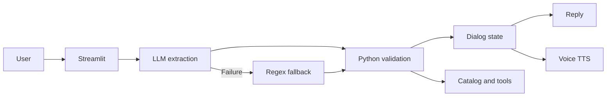

# CineBot Midterm Report

## 1. Summary

CineBot is a ticket assistant for a small theater. It can create a mock ticket order, list showtimes, and cancel a mock reservation.

- Order goal: five turns or fewer for at least 85 percent of valid requests.
- Slot F1 target: 90 percent.
- Out of scope rejection target: 90 percent.

The system uses gpt-4o-mini for extraction. Python validates each value and controls the dialog state. The app uses Streamlit.

## 2. System design

The app sends each user message to extraction.py. The model returns an intent and raw slot values in JSON. Python then resolves dates, number words, movie names, formats, and times.

Catalog values are checked against catalog.json. Invalid values are removed. A regex and keyword fallback runs when the model call fails.

dialog.py stores the current task and accepted slots. It asks for the first missing slot and shows a summary before it creates a mock reference.

### Tool call
The model can call check_availability through tools.py. Only the allow-listed function can run.

### Flow Chart

The voice path uses a manual start and stop recorder for input. Whisper converts audio to text -> the normal extraction path handles the text -> the tts-1 model reads the reply aloud.

## 3. Baseline results

The validation set had 24 utterances.
- Intent accuracy: 91.67 percent.
- Out of scope accuracy: 75 percent.
- Slot micro-F1: 98.18 percent.

Average extraction time was 1.10 seconds.

The main intent error was the difference between a request to see a movie and a request to check its showtimes. The model read “I wanna see Oppenheimer” as a showtime request.

The out of scope score was low because a billing case had a None label before Handoff became its own intent.

## 4. Changes from the baseline

The prompt gained a Handoff intent with examples for refunds, billing, groups, and accessibility. This separated human handoff cases from normal out of scope cases.

The prompt gained correction examples. These examples showed a Deny intent with a new movie, date, or format.

The prompt gained examples where “see” and “watch” mean a ticket request. This reduced the confusion between BookTickets and CheckShowtimes.

The fallback gained catalog and ticket value checks. It can also process a short answer such as Dune or Two when the prior assistant question asks for that slot.

The date resolver gained support for values such as Oct 15 and October 15.

The dialog reply now confirms a newly accepted slot. It then asks for the next missing slot. An invalid value stays out of state. The bot asks for that slot again.

The voice path now has one recorder key per recording. It also stores a digest of the last audio result. This stops the same recording from replaying after a Streamlit refresh.

The chat view now shows the user message before extraction finishes. The assistant message has a Thinking status during extraction.

## 5. Results after the changes

The improved validation set had 24 utterances.

Intent accuracy was 95.83 percent.

Out of scope accuracy was 100 percent.

Slot micro-F1 was 100 percent.

Average extraction time was 1.30 seconds.

The final test set had 35 utterances and three runs.

Intent accuracy was 91.43 percent.

Out of scope accuracy was 100 percent.

Slot micro-F1 was 92.54 percent.

All three runs gave the same intent result for every test row.

BookTickets remained the hardest intent. The three errors used “see” or “watch” without a clear ticket word. The other intent groups had full F1 scores.

## 6. Error analysis and requirement derivation

The error review led directly to the requirements in [midterm_requirements.md](./midterm_requirements.md).

The first issue was an incomplete first message. Users may provide only one value at a time. The bot must keep the task state and ask for the next value. This led to R2, which requires slot fill across several turns.

The second issue was a message with several values. A user may give a movie, date, time, format, and ticket count in one sentence. The bot must extract all valid values. This led to R3.

The third issue was the “see” versus “book” error. A simple keyword rule cannot always identify the user goal. The design therefore uses intent examples and a separate intent field. This supports R1 and A1.

The fourth issue was a bad date answer such as a phrase the resolver did not understand. A model can return a value that Python cannot verify. The validator must remove that value and ask the same question again. This led to R5 and A2.

The fifth issue was the date reply loop. The bot accepted a date but returned the date question again. A state check showed that the response did not acknowledge the value or advance the prompt. The dialog now compares state before and after each turn. It reports changed slots and asks the next missing slot. This is part of R2 and A3.

The sixth issue was a short answer such as Dune or Two. The model may return None for a short answer. The fallback now uses the prior assistant question. It treats Dune as a movie only after a movie question. It treats Two as a ticket count only after a ticket question. This supports R2, R3, and A4 without treating every use of Two as a ticket count.

The seventh issue was a slot that appeared full after a misunderstanding. A reply that repeats the same question has no valid slot value. The dialog must not alter state in that case. This rule follows from R5 and A2.

The eighth issue was repeated voice input. Streamlit can rerun the script after a component returns audio. The same bytes can then reach the speech service again. The digest guard and recorder reset came from this error. Voice is an optional bonus feature, but this fix keeps the normal text flow safe.

The ninth issue was a delayed chat message. The user message did not appear until the assistant reply was ready. The app now adds the user message before extraction and shows a load state for the assistant. This gives a clear response to the user during model latency.

These cases explain the main requirements. The requirement set asks for multi-turn slot fill, multi-slot extraction, corrections, catalog checks, confirmation, fallback extraction, cancel support, and a debug view. Each item maps to an observed user need or to an error from the first evaluation.

## 7. Hard cases

The BookTickets and CheckShowtimes boundary is the hardest intent boundary. A message with a ticket count or a time is easier to classify. A message with only “I want to see Dune” needs context and examples.

Ticket count is the hardest slot for the fallback. Phrases such as “me and my buddy” need language understanding. The model handles these phrases better than the simple regex path.

Informal text also causes errors. Examples include tkts, insideout2, and reservashun. The model can often recover the meaning. The fallback cannot recover every form.

Negation is another hard case. “I do not want IMAX” must produce Standard, not IMAX. The model can use the full sentence context. A simple entity rule may choose the wrong value.

## 8. Track B comparison

Track B would offer faster local intent checks and a clearer audit trail. It would also need many examples for short answers, typos, slang, and negation.

Track A handles varied language better. It costs more, adds network delay, and sends user text to OpenAI. Temperature zero gives stable results for the same prompt and history. A change in history can still change the result.

A useful future design would use Track B for clear cases. It would call the model only when the local score is low.

## 9. Limits and next steps

The catalog is static. A real app needs a ticket database and live seat checks. The booking result is a mock result. The date parser still needs support for phrases such as the weekend after next and ordinal dates. The handoff only gives contact details.

The next version should add live inventory, stronger date support, better typo maps, and a real human queue.

## 10. Bonus features

The tool path uses check_availability in tools.py. It returns showtimes and prices from catalog.json. The sidebar shows the tool name, input, and result.

The voice path uses Whisper for speech to text and tts-1 with the Nova voice for speech output. The app labels the recorder state and prevents duplicate audio results. Voice latency and text extraction latency appear in the sidebar.

## 11. AI assistance statement

An AI assistant wrote the first versions of extraction.py, dialog.py, app.py, evaluate.py, and the data files. The Design.md file set the main intent, slot, catalog, and prompt decisions. The code was reviewed before submission.

## 12. Data separation

The prompt examples are separate from the validation and test files. The validation set was used to tune the prompt and the synonym rules.

The test set was written before the initial code, with the help of our independent roommate. Test rows were not used during prompt changes. The final test ran after the changes were complete.
