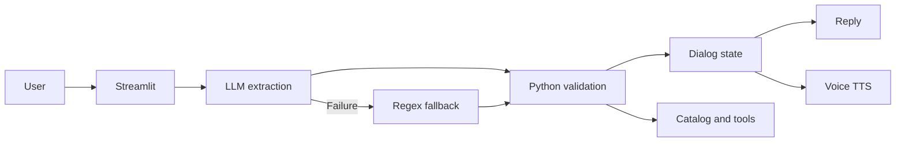
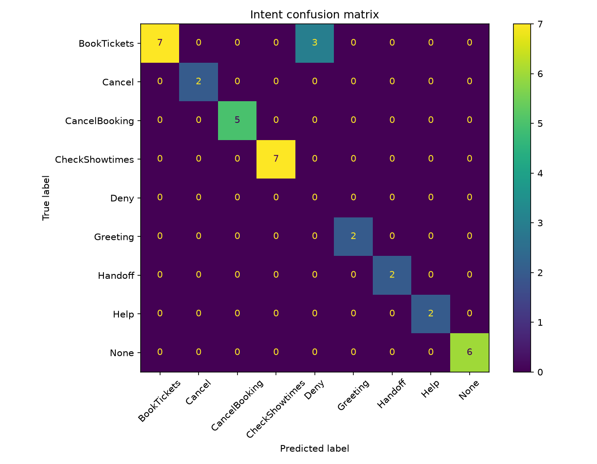

# Report

## 1. Summary

CineBot is a ticket assistant for a small theater. It can create a mock ticket order, list showtimes, and cancel a mock reservation.

- Order goal: five turns or fewer for at least 85 percent of valid requests.
- Slot F1 target: 90 percent.
- Out of scope rejection target: 90 percent.

The system uses gpt-4o-mini for extraction. Python validates each value and controls the dialog state. The app uses Streamlit.

## 2. System design

The app sends each user message to extraction.py. The model returns an intent and raw slot values in JSON. Python then resolves dates, number words, movie names, formats, and times.

Catalog values are checked against catalog.json. Invalid values are removed. A regex and keyword fallback runs when the model call fails.

dialog.py stores the current task and accepted slots. It asks for the first missing slot and shows a summary before it creates a mock reference.

### Tool call

The Track A agent supports the tool-call bonus from the requirements. When a
user asks about availability or pricing, the model can request
`check_availability` through tools.py. The function resolves movie synonyms,
checks the catalog, and returns showtimes, format, price per ticket, and date.
The result is sent back to the model before it gives the user a reply.

Python executes the request through an allow-list containing only
`check_availability`. Unknown function names return a rejection instead of
running. The agent loop is capped at five iterations. Tool name, input, and
result are stored in the sidebar debug view. This provides an auditable path
for the catalog lookup and supports the Track A tool-call bonus.

### Flow Chart

The voice path uses a manual start and stop recorder for input. Whisper
converts audio to text. The normal extraction path handles the text. The
tts-1 model reads the reply aloud. The recorder uses
`streamlit-mic-recorder`, and duplicate audio IDs are ignored.

Voice latency is measured from the completed recording through transcription
and text-to-speech. The sidebar shows extraction latency separately and shows
the combined speech latency for each voice turn. In the latest validation
run, average extraction latency was 2.55 seconds per turn. The evaluator also
reports average prompt tokens, completion tokens, and three-run consistency,
as required for Track A.

## 3. Baseline results

The validation set had 24 utterances.
- Intent accuracy: 91.67 percent.
- Out of scope accuracy: 75 percent.
- Slot micro-F1: 98.18 percent.

Average extraction time was 1.10 seconds.

The main intent error was the difference between a request to see a movie and a request to check its showtimes. The model read “I wanna see Oppenheimer” as a showtime request.

The out of scope score was low because a billing case had a None label before Handoff became its own intent.

## 4. Changes from the baseline

- The prompt gained a Handoff intent with examples for refunds, billing, groups, and accessibility. This separated human handoff cases from normal out of scope cases.
- The prompt gained correction examples. These examples showed a Deny intent with a new movie, date, or format.
- The prompt gained examples where “see” and “watch” mean a ticket request. This reduced the confusion between BookTickets and CheckShowtimes.
- The fallback gained catalog and ticket value checks. It can also process a short answer such as Dune or Two when the prior assistant question asks for that slot.
- The date resolver gained support for values such as Oct 15 and October 15.
- The dialog reply now confirms a newly accepted slot. It then asks for the next missing slot. An invalid value stays out of state. The bot asks for that slot again.
- The voice path now has one recorder key per recording. It also stores a digest of the last audio result. This stops the same recording from replaying after a Streamlit refresh.
- The chat view now shows the user message before extraction finishes. The assistant message has a Thinking status during extraction.

## 5. Results after the changes

The improved validation set had 24 utterances.
- Intent accuracy: 95.83 percent.
- Out of scope accuracy: 100 percent.
- Slot micro-F1: 100 percent.
- Average extraction time: 1.30 seconds.

The latest validation check reported:
- intent accuracy: 91.67 percent
- out-of-scope accuracy: 100 percent
- slot micro-F1: 100 percent
- average latency: 2.55 seconds per turn
- average tokens: 1,032 prompt and 33 completion tokens

The evaluator also saves an intent confusion matrix and supports three
test-set runs for the Track A consistency requirement. Voice latency is
measured separately in the sidebar because it includes Whisper and TTS time.
It reports intent accuracy and intent macro-F1 separately, along with the
classification report, so that a large intent class cannot hide weak
performance on a smaller class.

The final test set had 36 utterances and three runs. The added out-of-scope
example was not used in the prompt or in any tuning.

- run 1 intent accuracy: 91.67 percent
- run 2 intent accuracy: 88.89 percent
- run 3 intent accuracy: 91.67 percent
- mean intent accuracy: 90.74 percent
- intent macro-F1: 86.93 percent, 85.22 percent, and 86.93 percent by run
- mean intent macro-F1: 86.36 percent
- out-of-scope accuracy: 100 percent on all runs
- slot micro-F1: 80.49 percent, 79.52 percent, and 79.52 percent
- mean slot micro-F1: 79.84 percent
- mean latency: 2.21 seconds per turn
- mean prompt tokens: 1,030
- mean completion tokens: 33
- consistency: 35 of 36 rows, or 97.22 percent

BookTickets remained the hardest intent. The main errors used “see” or
“watch” without a clear ticket word. The other intent groups were stable,
although one CheckShowtimes prediction and one None prediction changed
between runs. The model is not fully deterministic even with temperature
zero because the tool-agent call and network responses can change the
context.

## 6. Error analysis and requirement derivation
We noticed the following issues during first evaluation and fixed them in the final design.

- Incomplete first message. Users may provide only one value at a time. The bot must keep the task state and ask for the next value. This led to R2, which requires slot fill across several turns.

- Message with several values. A user may give a movie, date, time, format, and ticket count in one sentence. The bot must extract all valid values. This led to R3.

-  “see” versus “book” error. A simple keyword rule cannot always identify the user goal. The design therefore uses intent examples and a separate intent field. This supports R1 and A1.

- Bad date answer such as a phrase the resolver did not understand. A model can return a value that Python cannot verify. The validator must remove that value and ask the same question again. This led to R5 and A2.

- Date reply loop. The bot accepted a date but returned the date question again. A state check showed that the response did not acknowledge the value or advance the prompt. The dialog now compares state before and after each turn. It reports changed slots and asks the next missing slot. This is part of R2 and A3.

- Short answer such as Dune or Two. The model may return None for a short answer. The fallback now uses the prior assistant question. It treats Dune as a movie only after a movie question. It treats Two as a ticket count only after a ticket question. This supports R2, R3, and A4 without treating every use of Two as a ticket count.

- Slot that appeared full after a misunderstanding. A reply that repeats the same question has no valid slot value. The dialog must not alter state in that case. This rule follows from R5 and A2.

- Repeated voice input. Streamlit can rerun the script after a component returns audio. The same bytes can then reach the speech service again. The digest guard and recorder reset came from this error. Voice is an optional bonus feature, but this fix keeps the normal text flow safe.

- Delayed chat message. The user message did not appear until the assistant reply was ready. The app now adds the user message before extraction and shows a load state for the assistant. This gives a clear response to the user during model latency.

These cases explain the main requirements. The requirement set asks for multi-turn slot fill, multi-slot extraction, corrections, catalog checks, confirmation, fallback extraction, cancel support, and a debug view. Each item maps to an observed user need or to an error from the first evaluation.

## 7. Hard cases

- The BookTickets and CheckShowtimes boundary is the hardest intent boundary. A message with a ticket count or a time is easier to classify. A message with only “I want to see Dune” needs context and examples.
- Ticket count is the hardest slot for the fallback. Phrases such as “me and my buddy” need language understanding. The model handles these phrases better than the simple regex path.
- Informal text also causes errors. Examples include tkts, insideout2, and reservashun. The model can often recover the meaning. The fallback cannot recover every form.
- Negation is another hard case. “I do not want IMAX” must produce Standard, not IMAX. The model can use the full sentence context. A simple entity rule may choose the wrong value.

## 8. The other track: what Track B would likely do

Track B would probably perform well on the clearest examples in this test
set, especially messages that contain an unmistakable action word, a movie
title, and a time or ticket count. A bag-of-words recognizer can be very
effective when a new message is close to one of its example utterances, and
it would make the BookTickets and CheckShowtimes boundary visible through its
scores. It would also be cheap to run because recognition happens locally,
with no API request for each turn.

The hardest cases in our test set are exactly the cases where Track B would
have the most trouble. Several BookTickets errors came from short requests
such as “I want to see Oppenheimer,” where the word “see” does not explicitly
say whether the user wants a ticket or showtime information. The Track B
examples could include both meanings, but adding more overlapping examples
would not guarantee a reliable distinction. The same problem appears in
correction messages such as “actually make it Tuesday instead of Friday.”
The meaning depends on the existing dialog state and on the fact that the
new date replaces only one previous value. Track A can give the whole
sentence and recent history to a model that has learned broader language
patterns, while Track B would need explicit state handling and carefully
designed examples around every likely correction.

Paraphrase, typos, slang, and negation would also favor Track A in this
domain. The test set includes informal forms such as “tkts,” compressed
movie names, and misspellings, as well as “I don't want the IMAX, just
regular seats.” A recognizer based on word overlap may score IMAX highly
even though the user is rejecting it. A synonym list and more examples can
help with known variations, but they make the recognizer increasingly
dependent on manual coverage. A pretrained transformer behind Track A is
more likely to connect “regular seats” with Standard and to understand that
the negated format is not the requested format. This is a likely advantage,
not a guarantee, since our own unstable handoff result shows that an LLM can
still make different choices across runs.

Track B would have the stronger control and auditability story. Its intent
examples, synonym lists, regex entities, and threshold are all visible in
the repository, and the same input should produce the same result on the
same version of the code. It would be easier to prove that a value came
from the catalog, that a score exceeded the selected threshold, and that an
unsupported request was sent to the fallback. Track A gives Python the
final authority over catalog validation, confirmation, cancellation, and
handoff, so our business rules are still protected, but the initial
classification and extraction remain probabilistic. The JSON schema makes
the boundary clearer, but it does not make the model's decision itself
fully auditable.

The tradeoff is not just accuracy. Track B has nearly zero marginal API
cost, lower and more predictable latency, and better privacy because user
messages stay local. Track A sends the message and a trimmed history to
OpenAI, incurs a small per-turn cost, and normally takes about 2.21 seconds
per turn in our final test. Track A also reports prompt and completion
tokens, which makes its cost measurable, while the final three-run
consistency of 97.22 percent shows that temperature zero does not guarantee
identical outputs in a networked tool-based system. Track B would be more
deterministic, although its behavior could still change when its examples
or threshold are changed.

A practical hybrid would use Track B as a fast local first pass. If the
recognizer found a strong score for a simple request such as “two tickets
for Dune at 7 PM,” Python could validate the slots and continue without an
LLM call. If the score were below a threshold, or if the message contained
negation, a correction, an unfamiliar spelling, or several competing
intent cues, the system could send it to the Track A extractor. The reverse
hybrid would also be useful: Track A could extract the language, while a
rule-based fast path could handle greetings, cancel commands, catalog
membership, and final confirmation. That arrangement would preserve the
paraphrase advantage of Track A while keeping predictable business rules,
privacy options, and low latency for routine turns.

## 9. Limits and next steps

The catalog is static. A real app needs a ticket database and live seat checks. The booking result is a mock result. The date parser still needs support for phrases such as the weekend after next and ordinal dates. The handoff only gives contact details.

The next version should add live inventory, stronger date support, better typo maps, and a real human queue.

## 10. Bonus features

- Tool call: `check_availability` uses an allow-listed Python dispatcher and
  returns showtimes and prices from catalog.json.
- Voice mode: Whisper provides speech to text and tts-1 with the Nova voice
  provides speech output.
- Voice timing: the sidebar reports extraction latency and combined voice
  latency. Duplicate audio results are ignored.

## 11. AI assistance statement

An AI assistant wrote the first versions of extraction.py, dialog.py, app.py, evaluate.py, and the data files. The DESIGN.md file set the main intent, slot, catalog, and prompt decisions. The code was reviewed before submission.

## 12. Data separation

The prompt examples are separate from the validation and test files. The validation set was used to tune the prompt and the synonym rules.

The test set was written before the initial code, with the help of our independent roommate. Test rows were not used during prompt changes. The final test ran after the changes were complete.
